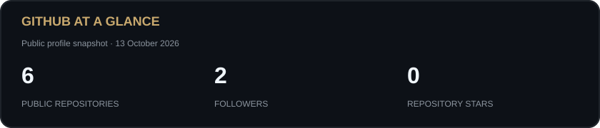

<h1 align="center">Hi, I'm Kitsanapuch 👋</h1>
<h3 align="center">Software Engineering Student at Thammasat University 🇹🇭</h3>

Building useful software with AI, machine learning, and human-centered thinking.

  
  

### 👨‍💻 About Me

- 🎓 Studying **Software Engineering at Thammasat University**.
- 🧠 Interested in **Machine Learning, Explainable AI, NLP, and Computer Vision**.
- 📱 Building web and mobile applications with **React Native, Expo, and TypeScript**.
- 🛠️ Working with **Python, FastAPI, ML pipelines, and IoT prototypes**.
- 🌱 Hands-on experience preparing datasets and training models for real-time plant nutrient deficiency detection.
- 💭 I believe AI can accelerate development, while human judgment, creativity, and empathy guide what we build.

### 🛠️ Tech Stack & Skills

**Languages & Web**

**App Development & Backend**

React Native · Expo · Full-Stack Development · SQL

**AI & Machine Learning**

Machine Learning · Scikit-Learn · XGBoost · Explainable AI (XAI) · Natural Language Processing (NLP) · YOLOv8 · AI Integration

**Tools & Hardware**

Git & Version Control · Software Testing · IoT Systems & Hardware Integration

### 🚀 Selected Projects

| Project | What I built | Technologies |
| :--- | :--- | :--- |
| **[ScamGraph AI](https://kitsanapuch.vercel.app/#projects)** | A web and mobile prototype for scam-risk assessment, with ML analysis, explainable results, and evidence relationships. | React Native, Expo, TypeScript, Python, FastAPI, ML |
| **[MySchool](https://kitsanapuch.vercel.app/#projects)** | A school portal for students, parents, teachers, and administrators, with AI tutoring and learning assistance. | React Native, Expo, Google Gemini AI |
| **[Plant Nutrient Deficiency Detection](https://kitsanapuch.vercel.app/#projects)** | An AI and IoT prototype for NPK deficiency detection, integrating real-time image detection and notifications. | Raspberry Pi 5, YOLOv8, CIRA CORE |

### 🏆 Achievement

**Bronze Award — Coding Thailand 2025, DEPA Thailand**  
AI-based plant nutrient deficiency detection project · National Round · Team of 3

### 📚 Research & Writing

- **[ScamGraph AI: Evidence-Linked and Explainable Scam-Risk Assessment for Thai-English Messages and URLs](https://kitsanapuch.vercel.app/papers/scamgraph-ai.pdf)** — Technical research manuscript documenting the prototype and its synthetic-data evaluation.
- **[AI Training Intelligence: Meta-Learning-Based Optimal Training Point Detection](https://kitsanapuch.vercel.app/papers/ai-training-intelligence.pdf)** — Research proposal exploring predictive training-stopping methods.

### 📊 GitHub Activity

[View my repositories and contributions →](https://github.com/Kitsanapuch?tab=repositories)

---

<i>Understand the problem. Build with purpose. Keep learning.</i>

