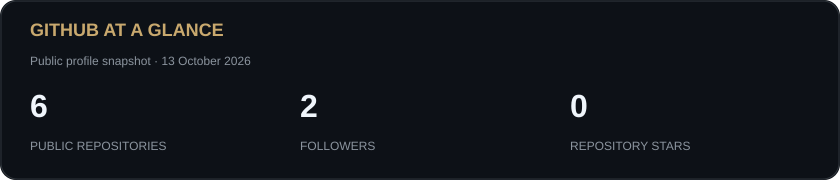

<h1 align="center">Hi, I'm Kitsanapuch 👋</h1>
<h3 align="center">Software Engineering Student at Thammasat University 🇹🇭</h3>

Software Engineering · Applied AI · Full-Stack Applications · Machine Learning

  
  
  

### 🧠 About Me

I'm a **Software Engineering student at Thammasat University**. I build practical web and mobile applications, and I explore how AI can make them more useful and understandable.

- 🧩 Currently building **[Physics Plus](https://github.com/Kitsanapuch/Physics-Plus-Website)**, a tutoring-center platform with student, teacher, and administrator workspaces.
- 🌱 Prepared datasets and trained models for **real-time plant nutrient deficiency detection**, connecting computer vision with a Raspberry Pi prototype.
- 🔎 Contributed to **ScamGraph AI**, combining ML-based scam-risk analysis, explainable results, and web/mobile workflows.
- 🤖 Integrated **Google Gemini AI** into MySchool for tutoring, quiz generation, and learning assistance.
- 🔬 Exploring **meta-learning, training dynamics, and predictive early stopping** through the AI Training Intelligence research proposal.
- 💭 I value careful evaluation, clear explanations, and human judgment when developing AI systems.

### 🔭 Current Work: Physics Plus

**[Physics Plus — Tutoring Center Platform](https://github.com/Kitsanapuch/Physics-Plus-Website)** · Project owner and web developer · [Live site](https://physicsplus.vercel.app/)

An active full-stack project that connects course discovery and enrollment with class schedules, teaching-hour records, billing, and administrator review. It has role-specific experiences for students, teachers, and administrators across 16 group and one-on-one courses. I work on the Flask application, its Turso-backed workflows, in-app notifications, and asynchronous Google Sheets sync.

### 🧠 AI & Machine Learning

**Artificial Intelligence (AI) · Machine Learning · Explainable AI (XAI) · Natural Language Processing (NLP) · Scikit-Learn · XGBoost · AI Integration & Application**

#### Applied AI Experience

| Focus | Experience |
| :--- | :--- |
| **ML Application Integration** | Integrated ML-based risk analysis into ScamGraph AI, connecting analysis results, scan history, reporting, and relationship graph features. The prototype uses synthetic data and requires real-world evaluation. |
| **Computer Vision & Model Training** | Prepared datasets and trained models for plant nutrient deficiency detection, with YOLOv8, CIRA CORE, and real-time image detection. |
| **Generative AI Applications** | Integrated Google Gemini AI into MySchool for AI Tutor, Teacher Copilot, quiz generation, and Family Advisor. |
| **AI + IoT Prototyping** | Built a plant nutrient deficiency detection prototype using Raspberry Pi 5, LINE notifications, and a 3D-printed enclosure. |
| **AI Backend & Cross-Platform Testing** | Connected AI workflows with Python/FastAPI and React Native/Expo; tested web and iOS Simulator flows and resolved API connectivity and result-display issues. |

**Research interests:** Meta-learning · Learning-curve prediction · Early stopping · Computational efficiency

*AI Training Intelligence is a research proposal, not a completed experimental system.*

### 🛠️ Software Engineering & Tools

**Languages & Web**

**Applications & Backend**

React Native · Expo · Flask · FastAPI · Turso (libSQL) · SQL · API Integration · Vercel Queue

**Development Workflow**

Git & Version Control · Branching & Merging · Software Testing · Debugging · Team Collaboration

### 🚀 Selected Projects

| Project | What I built | Technologies |
| :--- | :--- | :--- |
| **[Physics Plus](https://github.com/Kitsanapuch/Physics-Plus-Website)** · [Live](https://physicsplus.vercel.app/) | An active tutoring-center platform connecting enrollment, scheduling, teaching operations, billing, and three role-based workspaces. | Python, Flask, JavaScript, Turso, Vercel Queue |
| **[ScamGraph AI](https://github.com/Kitsanapuch/ScamGraph-AI)** | A web and mobile prototype for scam-risk assessment, with ML analysis, explainable results, and evidence relationships. | React Native, Expo, TypeScript, Python, FastAPI, ML |
| **[MySchool](https://kitsanapuch.vercel.app/#projects)** | A school portal for students, parents, teachers, and administrators, with AI tutoring and learning assistance. | React Native, Expo, Google Gemini AI |
| **[Plant Nutrient Deficiency Detection](https://kitsanapuch.vercel.app/#projects)** | An AI and IoT prototype for NPK deficiency detection, integrating real-time image detection and notifications. | Raspberry Pi 5, YOLOv8, CIRA CORE |

### 🏆 Achievement

**Bronze Award — Coding Thailand 2025, DEPA Thailand**  
AI-based plant nutrient deficiency detection project · National Round · Team of 3

### 📚 Research & Writing

- **[ScamGraph AI: Evidence-Linked and Explainable Scam-Risk Assessment for Thai-English Messages and URLs](https://kitsanapuch.vercel.app/papers/scamgraph-ai.pdf)** — Technical research manuscript documenting the prototype and its synthetic-data evaluation.
- **[AI Training Intelligence: Meta-Learning-Based Optimal Training Point Detection](https://kitsanapuch.vercel.app/papers/ai-training-intelligence.pdf)** — Research proposal exploring predictive training-stopping methods.

### 📊 GitHub Activity

[View my repositories and contributions →](https://github.com/Kitsanapuch?tab=repositories)

---

<i>Understand the problem. Build with purpose. Keep learning.</i>

